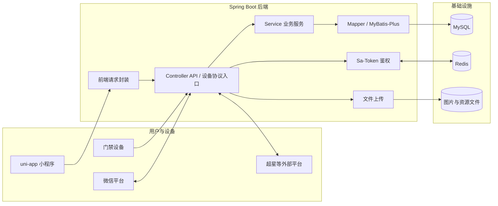
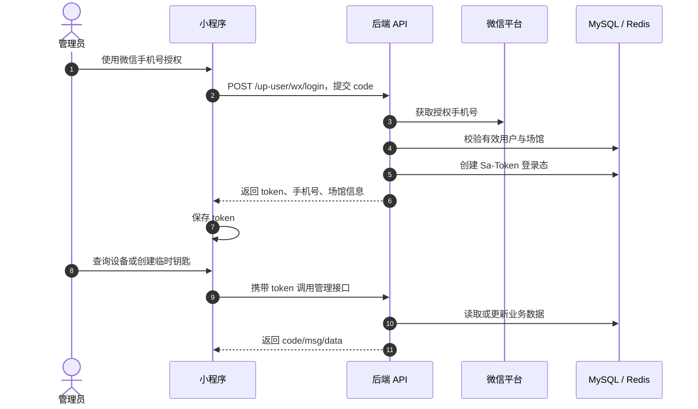
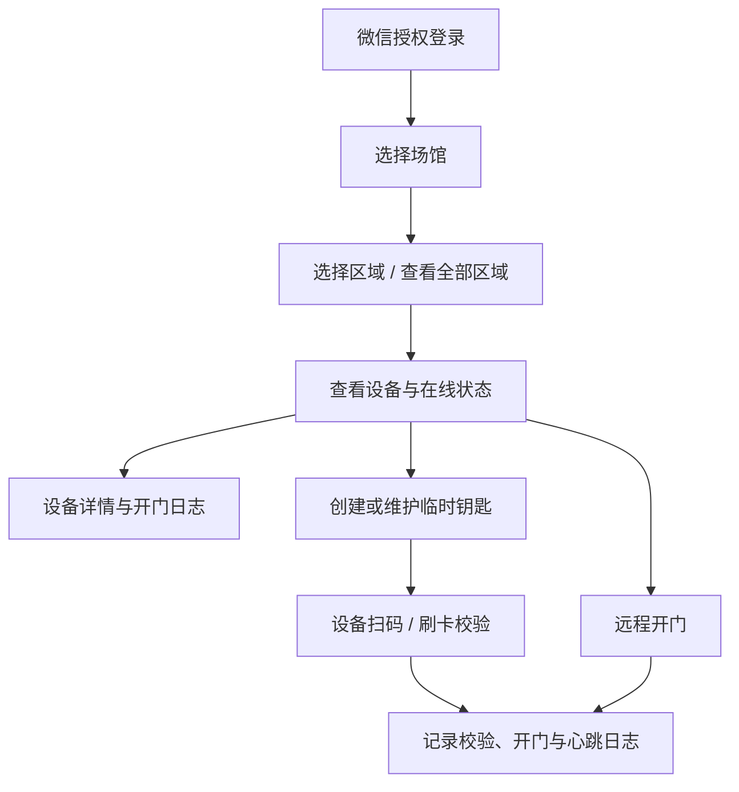
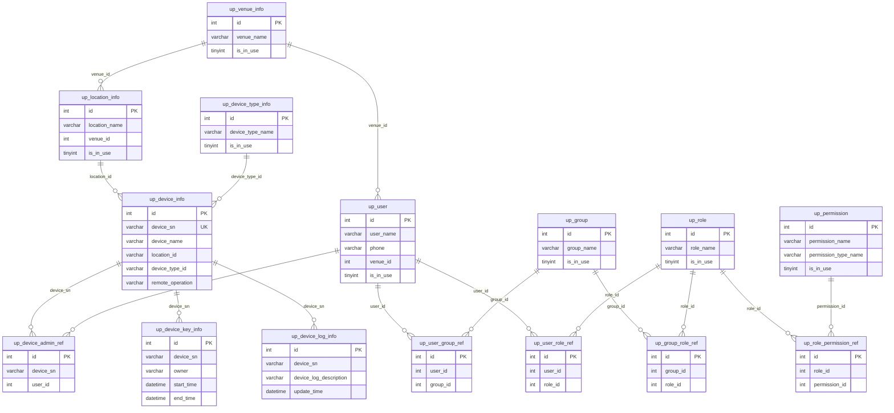

# 智慧场馆 IoT 管理系统

一套由 uni-app 小程序和 Spring Boot 服务组成的场馆设备管理系统。小程序面向场馆管理员，用于管理场馆、区域、门禁设备、临时钥匙和开门记录；后端提供管理 API，并接收门禁设备的鉴权与心跳回调。前后端位于独立仓库：当前仓库为后端，[前端仓库 upCloudTechFrontend](https://github.com/shenliliaff/upCloudTechFrontend)。

## 项目结构

| 目录 | 作用 | 主要技术 |
| --- | --- | --- |
| `src/main/java/`、`src/main/resources/` | REST API、登录鉴权、设备协议处理、数据访问与配置 | Java、Spring Boot、MyBatis-Plus、MySQL、Redis、Sa-Token |
| `IOTBackend.sql` | 开发/初始化用建表脚本 | MySQL |
| `up_prod.sql` | 生产库结构导出 | MySQL |
| [前端独立仓库](https://github.com/shenliliaff/upCloudTechFrontend) | 管理端小程序页面、Vuex 状态和 API 请求封装 | uni-app、Vue 2、JavaScript |

## 系统原理

小程序通过统一请求层访问后端；后端 Controller 负责 HTTP/设备协议入口，Service 承载业务逻辑，Mapper/MyBatis-Plus 访问 MySQL。登录态由 Sa-Token 管理，Redis 用作令牌存储；设备回调将心跳、开门事件写入设备日志。



### 典型业务流程



设备侧的 `CheckCode`、`QueryCmd`、`QueryCmdPostData` 是门禁协议入口，不走小程序统一的 `ResultData` 响应结构。设备鉴权会校验临时钥匙或调用外部平台，并记录开门/心跳结果。

## 功能模块

### 前端

前端源代码位于独立仓库 [shenliliaff/upCloudTechFrontend](https://github.com/shenliliaff/upCloudTechFrontend)，不是当前后端仓库的子目录。前端使用 uni-app/Vue 2 和 Vuex，登录页获取微信手机号授权；请求封装统一拼接 API 地址、携带 `token`，并处理登录失效。设备、场地、管理员、临时钥匙、开门记录和班牌配置等页面通过后端接口完成业务操作。

| 页面/目录 | 功能 |
| --- | --- |
| `pages/login/`、`pages/index/` | 登录、进入场馆与设备列表 |
| `pages/deviceDetail/`、`pages/editDevice/` | 查看设备状态与日志、修改设备信息；含班牌设备详情页 |
| `pages/devicePositionManagement/`、`pages/addPlace/`、`pages/editPlace/` | 管理区域/教室及其设备 |
| `pages/addManager/` | 维护设备管理员 |
| `pages/secretKeyManagement/`、`pages/addSecretKey/`、`pages/secretKeyDetail/`、`pages/sharePage/` | 创建、编辑、查看和分享临时钥匙 |
| `pages/openRecords/` | 查看设备开门记录 |
| `pages/applyAppointment/` | 预约申请页面 |
| `pages/unbinding/`、`pages/inputPage/`、`pages/singleImage/` | 解绑及辅助输入、图片展示流程 |
| `common/request/` | 为 JSON 请求和文件上传附加 token，并处理统一响应码 |
| `store/` | 前端状态及混入逻辑 |

### 后端

| 包/业务 | 职责 |
| --- | --- |
| `controller/` | 用户、场馆、区域、设备、钥匙、日志、上传、微信认证等 HTTP 入口 |
| `service/`、`service/impl/` | 业务查询、数据更新、登录与设备规则处理 |
| `mapper/`、`resources/mapper/` | MyBatis Mapper 接口和 SQL 映射 |
| `entity/` | 数据实体与 `ResultData` 统一响应模型 |
| `config/` | Sa-Token、跨域、上传和 MVC 配置 |
| `exception/` | 全局异常处理 |
| `util/` | 微信及通用工具 |
| `generator/` | MyBatis-Plus 代码生成工具 |

### 用户与设备主流程



## 数据模型

### 业务实体

| 领域 | 表 | 用途 |
| --- | --- | --- |
| 场馆与设备 | `up_venue_info`、`up_location_info`、`up_device_info`、`up_device_type_info` | 场馆、区域、设备及设备类型 |
| 用户与授权 | `up_user`、`up_role`、`up_permission`、`up_group` | 用户、角色、权限和用户组 |
| 关系表 | `up_user_role_ref`、`up_user_group_ref`、`up_role_permission_ref`、`up_group_role_ref` | 用户、用户组、角色和权限之间的关联 |
| 设备权限与记录 | `up_device_admin_ref`、`up_device_key_info`、`up_device_log_info` | 设备管理员、临时钥匙/预约、开门与心跳日志 |

### ER 图



> **关系说明：** Mermaid 连线表示根据字段名和业务查询得到的逻辑关系，不代表数据库已声明外键。`up_device_info.location_id`、`device_type_id` 是字符串列，而关联实体主键为整数；设备记录、钥匙和日志主要通过 `device_sn` 关联。不同 SQL 脚本的字段、索引约束也不完全相同，部署前应对照目标数据库 schema。

## 接口文档

### 通用约定

- 后端默认端口为 `8091`；前端请求基址配置在前端仓库的 `static/config/index.js`。仓库当前配置指向线上服务，联调前应按目标环境调整。
- 小程序请求封装会从本地存储读取 `token`，并通过同名 HTTP Header 发送。管理 API 的成功响应通常为 `{"code":200,"msg":"...","data":...}`。
- 常见响应码：`200` 成功，`301`/`302`/`303` 登录态缺失或失效，`304` 密码错误，`305` 用户不存在，`400` 通用失败，`401` 参数错误，`404` 记录不存在。
- “登录校验”表示 Controller 明确调用了 Sa-Token 登录检查；“未显式校验”表示该 Controller 未执行此检查，部署时应结合网关、设备网络策略和实际业务评估，不应默认视为公开安全接口。
- 管理 API 返回 `ResultData`；门禁回调返回设备协议原始 JSON 字符串；微信认证接口返回纯文本。

### 登录与场馆

| 方法 | 路径 | 登录校验 | 参数 | 说明 |
| --- | --- | --- | --- | --- |
| GET | `/up-user/get-users` | 是 | Query: `venueId` | 查询场馆用户 |
| POST | `/up-user/login` | 未显式校验 | JSON: `phone` | 按手机号检查用户是否存在；当前实现未在此方法中创建登录态 |
| POST | `/up-user/wx/login` | 否，登录入口 | JSON: 微信 `code` | 获取微信授权手机号并校验有效用户，成功后建立 Sa-Token 登录态 |
| POST | `/up-user/wx/logOut` | 依赖当前登录态 | 无 | 清理用户令牌并退出登录 |
| GET | `/up-venue-info/get-locations-devices` | 是 | Query: `venueId` | 查询场馆下区域和设备 |
| GET | `/up-venue-info/get-all-venues` | 是 | 无 | 查询所有有效场馆 |
| GET | `/up-user-role-ref/get-users-by-roleName` | 是 | Query: `venueId`, `roleName` | 按场馆和角色查询用户 |

### 区域与设备

| 方法 | 路径 | 登录校验 | 参数 | 说明 |
| --- | --- | --- | --- | --- |
| GET | `/up-location-info/get-devices` | 是 | Query: `locationId`, `venueId`（全部区域时 `locationId=-1`） | 按区域或场馆查询设备及在线状态 |
| GET | `/up-location-info/get-pad-devices` | 是 | Query: `locationId`, `venueId`（全部区域时 `locationId=-1`） | 查询班牌设备 |
| GET | `/up-location-info/get-all-locations` | 是 | Query: `venueId` | 查询场馆区域，并在返回列表前添加“全部”选项 |
| POST | `/up-location-info/add-location` | 是 | JSON: `venueId`, `locationName`, `creator` | 新增区域 |
| POST | `/up-location-info/update-location` | 是 | JSON: `locationId`, `locationName`, `modifier` | 修改区域名称 |
| POST | `/up-location-info/delete-location` | 是 | JSON: `locationId`, `modifier` | 逻辑删除/停用区域 |
| POST | `/up-location-info/update-location-detail-info` | 未显式校验 | JSON: `locationId`, `locationName`, `modifier`, `area`, `volume`, `desc`, `image` | 更新区域详情；扩展字段保存在详情数据中 |
| GET | `/up-location-info/get-location-detail` | 未显式校验 | Query: `deviceSn` | 通过设备查询区域详情 |
| GET | `/up-device-info/get-devices` | 是 | Query: `id`（区域编号） | 查询区域设备 |
| GET | `/up-device-info/get-device-status` | 是 | Query: `deviceSn` | 根据最近设备日志判断在线状态 |
| GET | `/up-device-info/get-device-detail-info` | 是 | Query: `deviceSn`, `pageNum` | 查询设备详情及分页/条数限制的日志信息 |
| POST | `/up-device-info/update-device-name-info` | 是 | JSON: `deviceSn`, `deviceName` | 修改设备名称 |
| POST | `/up-device-info/update-device-location-info` | 是 | JSON: `deviceSn`, `LocationId` | 修改设备所属区域 |
| POST | `/up-device-info/remote_open_door` | 是 | JSON: `deviceSn`, `remoteOperation`, `modifier` | 提交远程开门操作 |
| GET | `/up-device-info/get-pad-device-Detail` | 未显式校验 | Query: `deviceSn` | 查询班牌信息并访问其外部数据源 |
| POST | `/up-device-info/update-device-img-info` | 是 | JSON: `deviceSn`, `bgImg`, `type`, `logo`, `selfDefine`, `dataSourceType`, `dataSource`, `versionCode`, `bannerImages`, `otherUrl`, `updateUrl` | 更新班牌展示配置 |
| GET | `/up-device-info/get-pad-other-room-info` | 未显式校验 | Query: `deviceSn`, `otherUrl` | 请求指定外部地址并返回房间信息 |
| GET | `/up-device-admin-ref/get-device-admins` | 是 | Query: `deviceSn` | 查询设备管理员 |
| POST | `/up-device-admin-ref/add-device-admins` | 未显式校验 | JSON: `deviceSn`, `userId`, `creator` | 添加设备管理员 |

### 临时钥匙与设备回调

| 方法 | 路径 | 登录校验 | 参数 | 说明 |
| --- | --- | --- | --- | --- |
| GET | `/up-device-key-info/get-device-key-info` | 是 | Query: `deviceSn` | 查询设备钥匙/预约列表 |
| POST | `/up-device-key-info/create-device-key-info` | 是 | JSON: `deviceSn`, `phone`, `owner`, `startTime`, `endTime`, `creator` | 创建临时钥匙 |
| POST | `/up-device-key-info/update-device-key-info` | 是 | JSON: `deviceKeyId`, `phone`, `owner`, `startTime`, `endTime`, `modifier` | 修改临时钥匙 |
| POST | `/up-device-key-info/delete-device-key` | 是 | JSON: `deviceKeyId`, `modifier` | 停用临时钥匙 |
| GET | `/up-device-key-info/get-device-key-share-info` | 是 | Query: `deviceKeyId` | 查询分享信息 |
| POST | `/up-device-key-info/CheckCode` | 设备协议入口 | JSON: `SN`, `CodeVal`, `CodeType`, `IsOnline` | 校验刷卡/扫码请求，响应门禁协议状态并记录结果 |
| POST | `/up-device-key-info/QueryCmd` | 设备协议入口 | JSON: `SN`, `DoorMagnetic` | 设备轮询命令并更新心跳/门磁状态 |
| POST | `/up-device-key-info/QueryCmdPostData` | 设备协议入口 | JSON: `SN`, `CmdID`, `CmdStatus` | 接收设备命令执行结果并记录日志 |

### 日志、文件与微信回调

| 方法 | 路径 | 登录校验 | 参数 | 说明 |
| --- | --- | --- | --- | --- |
| GET | `/up-device-log-info/get-device-log-info` | 是 | Query: `deviceSn`, `pageNum` | 查询并格式化设备开门记录 |
| POST | `/up-device-log-info/update-device-log-info` | 未显式校验 | JSON: `deviceSn`, `log` | 写入设备日志 |
| GET | `/up-device-log-info/get-device-log-test-info` | 未显式校验 | Query: `deviceSn`, `pageNum` | 测试用途日志查询 |
| POST | `/upload/img` | 是 | Multipart: `file` | 上传图片或班牌 APK，返回资源 URL |
| GET | `/upNotification/notificationAuth` | 微信平台回调 | Query: `signature`, `timestamp`, `nonce`, `echostr` | 校验微信服务器并回显 `echostr` |

> `up-role`、`up-group`、`up-permission`、`up-user-group-ref`、`up-group-role-ref`、`up-role-permission-ref` 和 `up-device-type-info` 当前只有 Controller 路径声明，没有已实现的业务处理方法，因此未列为可用接口。历史 `TblUserController` 中注释掉的路由也不属于当前 API。

## 本地运行

### 后端

1. 安装与项目配置兼容的 JDK、MySQL 和 Redis。当前 `pom.xml` 的 `java.version` 为 `1.8`；`HELP.md` 中的说明与该值不一致，请以实际构建配置为准。
2. 在本地配置 `src/main/resources/application-dev.yml` 中的数据源、Redis 连接及文件存储路径。不要将密码或密钥提交到版本库。
3. 从后端仓库根目录启动：

```powershell
.\mvnw.cmd spring-boot:run "-Dspring-boot.run.profiles=dev,token"
```

默认服务端口为 `8091`。如果本机环境使用不同端口或 profile，请按本地配置调整启动参数。

4. 执行测试：

```powershell
.\mvnw.cmd test
```

### 数据库

初始化前先备份并确认目标 schema。`IOTBackend.sql` 和 `up_prod.sql` 都包含 `DROP TABLE`，会删除并重建同名表；不要直接对已有生产库执行。两份脚本在用户字段、关系表约束等方面存在差异，应用程序实际依赖的表结构应以部署环境为准。

### 前端

1. 克隆并使用 HBuilderX 打开[前端仓库](https://github.com/shenliliaff/upCloudTechFrontend)。
2. 修改 `static/config/index.js` 中的 API 基址，指向本地或测试后端；不要默认把开发调试请求发往线上环境。
3. 使用 HBuilderX 运行到微信开发者工具或目标设备。登录成功后，请求封装会自动从本地存储附加 `token`。

## 配置与安全提示

- 仓库中的环境配置应仅作为结构参考。部署时通过安全的本地配置或环境变量提供数据库、Redis、微信和外部平台凭据，并轮换已暴露的凭据。
- 设备协议回调和部分未显式校验登录的接口需要通过网络隔离、设备侧签名/白名单或网关策略保护；请按实际设备协议确认防护措施。
- `get-pad-other-room-info` 接收调用方传入的 `otherUrl` 并向该地址发起请求。部署前应限制允许访问的目标，避免服务端被用于访问非预期地址。
- `/upload/img` 接受文件上传。反向代理、应用层大小限制、扩展名/MIME 校验和存储目录权限应结合部署环境配置。

## 相关文件

- [后端构建配置](pom.xml)
- [后端源码](src/main/java/)
- [前端项目及说明](https://github.com/shenliliaff/upCloudTechFrontend)
- [开发数据库脚本](IOTBackend.sql)
- [生产数据库结构导出](up_prod.sql)
